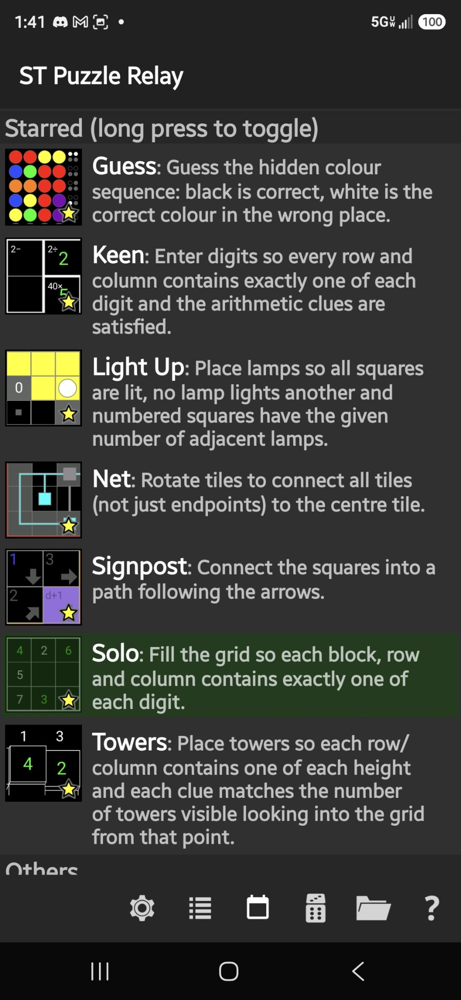
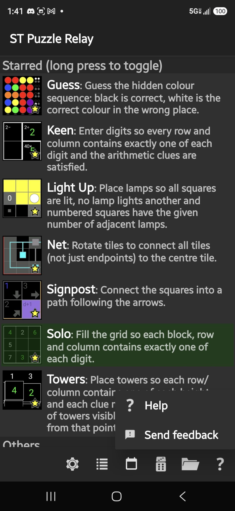
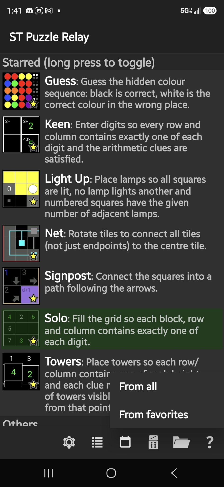
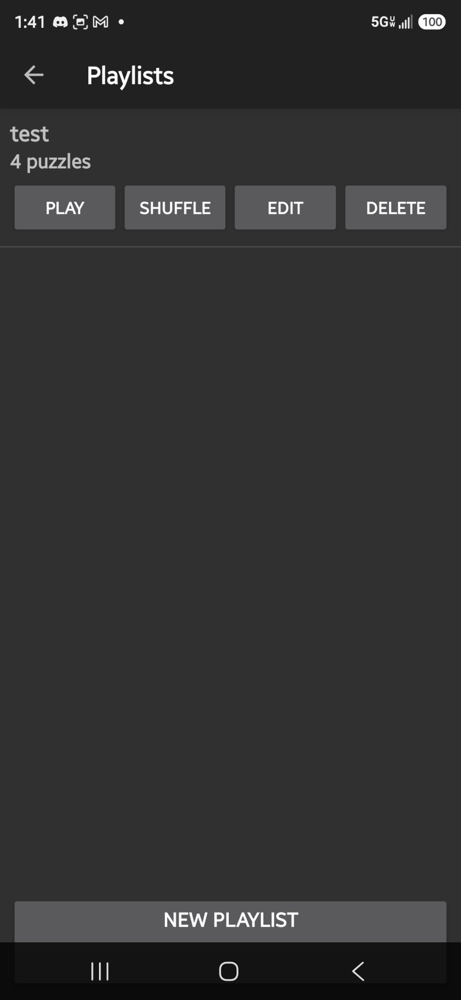
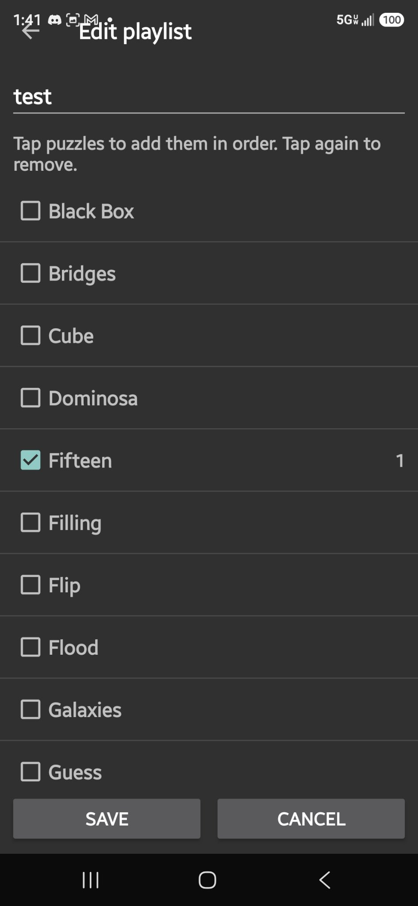

# ST Puzzle Relay

**Simon Tatham's Puzzle Relay — with playlists, dailies, timers, and a random picker.**

This is a fork of [chrisboyle/sgtpuzzles](https://github.com/chrisboyle/sgtpuzzles),
which is [Simon Tatham's Portable Puzzle Collection](https://www.chiark.greenend.org.uk/~sgtatham/puzzles/)
ported to Android.

## Screenshots

| Puzzle list | Help submenu (opens upward) |
|---|---|
|  |  |
| Random picker | Playlists |
|---|---|
|  |  |
| Edit playlist | |
|---|---|
|  | |

## Credits and license

All credit for the puzzles themselves goes to Simon Tatham, Chris Boyle, and the
contributors listed in the LICENCE file. This fork is distributed under the same
MIT-style license — see the LICENCE file; copyright notices are preserved.

## What this fork adds

The upstream port deliberately stays close to upstream's design; this fork adds
the things it chose not to:

* A solve timer that starts on your first move and pauses when you leave the
  puzzle, so time away from the game doesn't count.
* Named, ordered playlists with Next-on-solve and shuffle.
* A date-seeded daily puzzle that rotates through the enabled puzzles — everyone
  gets the same puzzle each day, with per-day completion tracking.
* A random picker that draws from all puzzles or just your favorites
  (long-press a puzzle on the main screen to star it).

## Current state

v1 ships a curated subset of ten puzzles: Loopy, Mines, Dominosa, Bridges,
Mosaic, Net, Palisade, Pattern, Pearl, and Tents. The full ~40-puzzle set will
return in a later release.

## About this project

This is my first-ever project. I'm learning Android development by building it,
in collaboration with an AI coding assistant — yes, it's vibe coded, and I'm not
going to pretend otherwise. Feedback, bug reports, and pull requests are welcome.

Coders should read on...

Prerequisites
-------------

Some knowledge of Android Development and/or C, and ideally JNI, depending
on what you want to work on: the puzzles themselves are in C, most
Android-specific code is in Kotlin, and JNI (Java Native Interface) is the
API bridge between the two.

If you have the option, a Linux-based development machine, as I haven't
tried to build on Windows or OSX, and it will need some tweaks.

[Android Studio](https://developer.android.com/studio)

[Android NDK (Native Development Kit)](https://developer.android.com/ndk)

If using gradle directly, create `local.properties` with `sdk.dir=/your_path_here`
(I think Android Studio writes this automatically)

I probably missed a few things here. File a bug when you find them. :-)

Getting/configuring the source
------------------------------

This is a fork of https://github.com/chrisboyle/sgtpuzzles - you can clone/download
it from there if you want the unmodified upstream port, or clone this repo for
the fork. A fork means you can easily send me a "pull request" of your change,
and I can review and integrate it, all within github.

You'll also find a branch called `upstream`, which is Simon's code whenever
I last synced. Handy for diffs, to see what I broke on Android. :-)

This repository includes old `git-svn` commits that predate upstream's move
to git. History will look slightly nicer if, after cloning, you do:

    git fetch origin 'refs/replace/*:refs/replace/*'

Sadly github itself does not appear to support replacement so you will still
see duplicates there.

You should now be able to edit, build and launch the app like any other Android
project (except a lot of it is in C). Don't forget that you'll be signing with
a dev key, so to test on a device that already has the Google Play version,
uninstall that first.

Architecture / where to find stuff
----------------------------------

Simon has some excellent [developer documentation](https://www.chiark.greenend.org.uk/~sgtatham/puzzles/devel/)
which is definitely worth reading first, at least the Introduction.

The Android front-end (`android.c`) is basically just glue, passing everything to
Kotlin. The Kotlin classes providing the UI layer, game chooser, etc. are in
`app/src/main/kotlin`.  The main class `GamePlay` has the native methods that
`android.c` implements. The game area on screen is a `GameView`, which basically
just has a bitmap for the puzzle to draw on. Note that almost no native code is
run until the user has chosen a game (unless there's a previous game to resume).

Files for other platforms etc. that are not currently usable in this fork are
in the `not-in-use` directory.

If your change is relevant to other platforms, you should definitely ping Simon
about it as well as me, but test on at least one other platform first in a
separate checkout (see above).

Happy hacking!

--
ST Puzzle Relay
